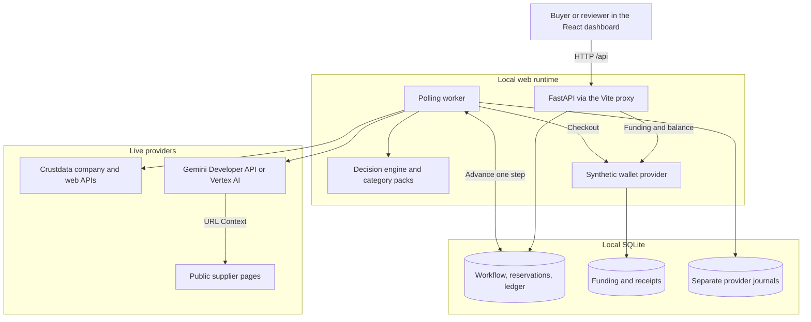
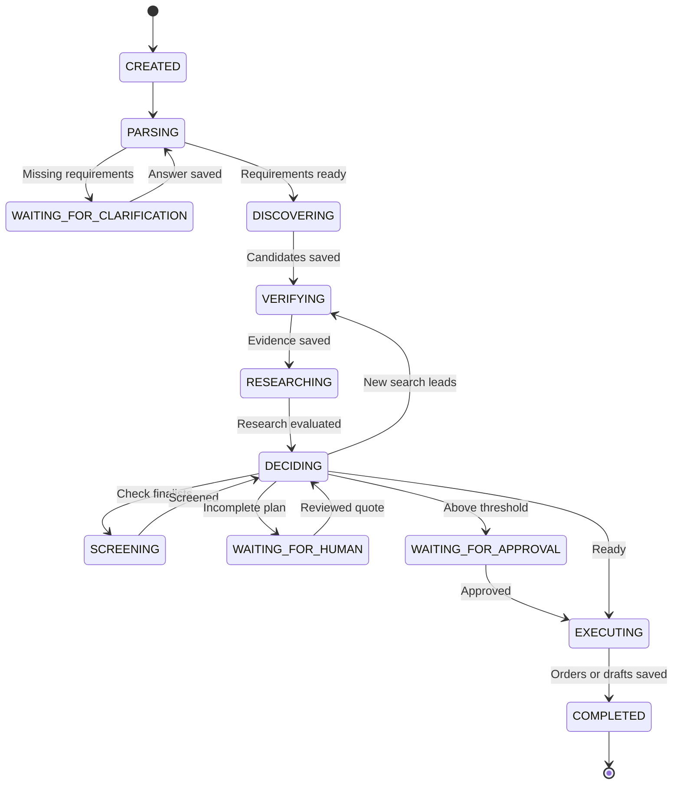
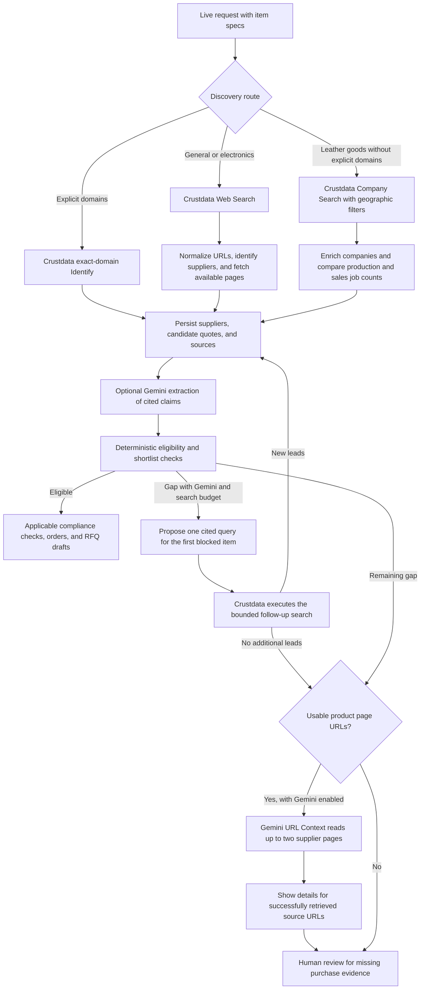
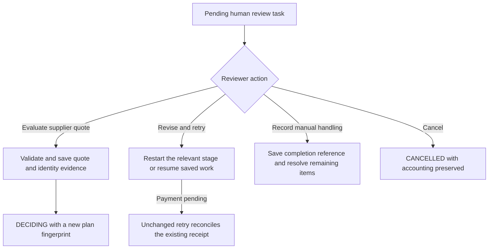
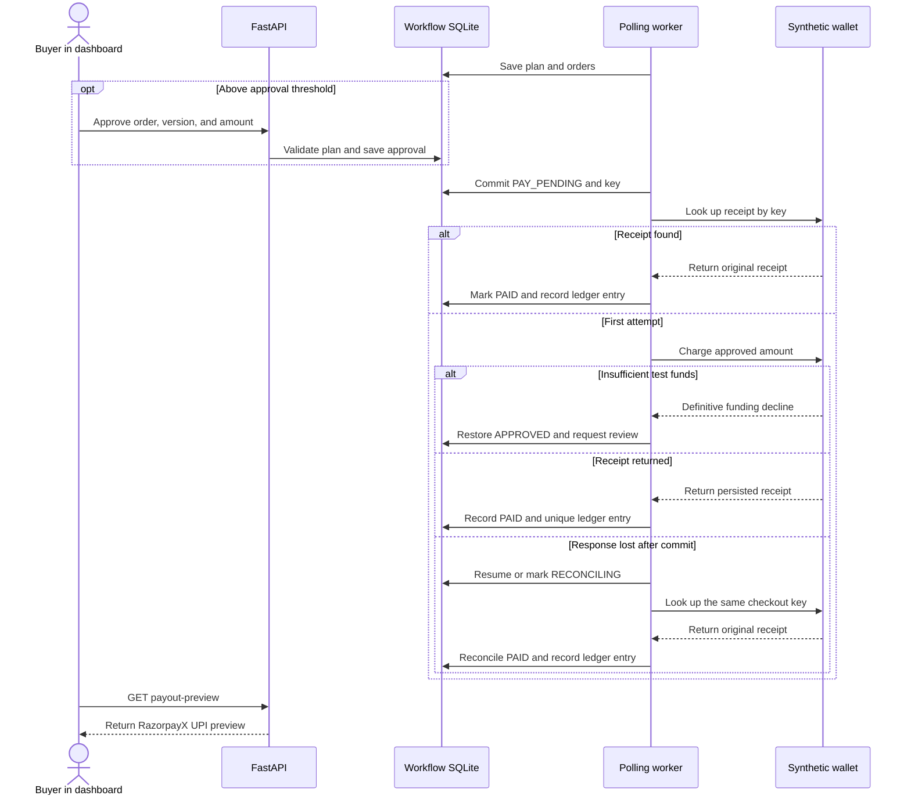
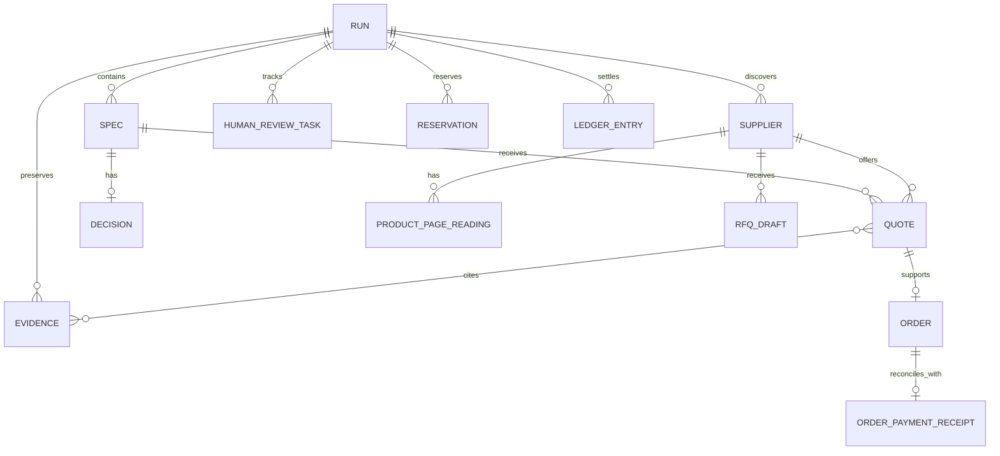
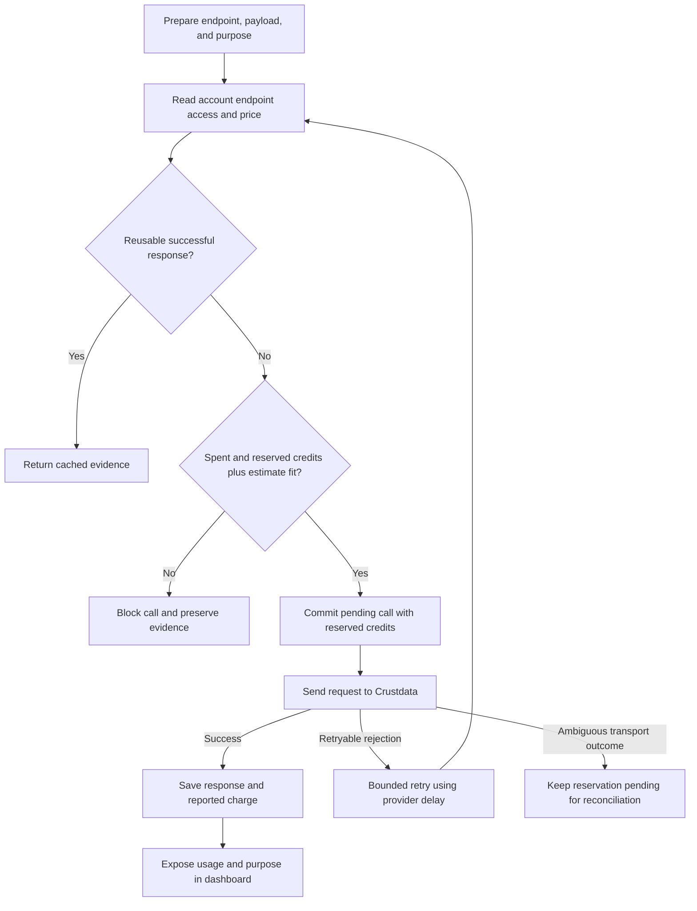
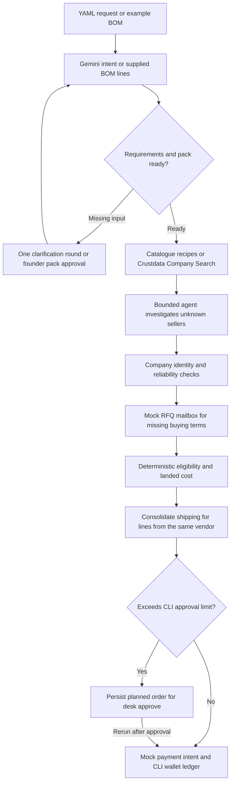

# Sourcing Desk architecture and workflows

This is the detailed architecture document from the team fork. It describes the prototype at the time it was written; use the [current README](README.md) for setup, deployment, and current paths.

Sourcing Desk is a local procurement prototype for turning product or service requirements into evidence-backed supplier decisions. The web dashboard supports a purchase plan with synthetic checkout or a supplier shortlist with unsent requests for quotation (RFQs). Crustdata provides live company and web evidence. Google Gemini interprets requests, extracts supplier claims, proposes a better search when useful, and reads selected product pages. Deterministic code controls eligibility, approvals, and wallet debits.

The standalone Python CLI and notebook have their own execution engine, category packs, mock RFQ mailbox, databases, and synthetic wallet.

## Contents

- [Run the dashboard](#run-the-dashboard)
- [System architecture](#system-architecture)
- [Run lifecycle](#run-lifecycle)
- [Live sourcing and Gemini](#live-sourcing-and-gemini)
- [Eligibility and landed cost](#eligibility-and-landed-cost)
- [Human review and quote intake](#human-review-and-quote-intake)
- [Synthetic checkout and recovery](#synthetic-checkout-and-recovery)
- [Persistence and accounting](#persistence-and-accounting)
- [HTTP API](#http-api)
- [Team CLI and notebook](#team-cli-and-notebook)
- [Tests and contract generation](#tests-and-contract-generation)
- [Operational limits](#operational-limits)

## Run the dashboard

The dashboard uses Python 3.11+, FastAPI, Pydantic, SQLAlchemy, and SQLite on the backend. The frontend uses React 19, TypeScript, Vite 6, and Tailwind CSS 4. Use Node.js 20.19+ or 22.12+.

From the repository root in PowerShell, create the environment.

```powershell
python -m venv .venv
.\.venv\Scripts\python.exe -m pip install -e ".\backend[test]"
```

Start the API and worker in separate terminals, both from the repository root.

```powershell
# Terminal 1
.\.venv\Scripts\python.exe -m uvicorn app.main:app --app-dir backend --host 127.0.0.1 --port 8000

# Terminal 2
.\.venv\Scripts\python.exe -m app.workflow.worker
```

Start the frontend in a third terminal.

```powershell
Set-Location frontend
npm.cmd ci
npm.cmd run dev
```

Vite proxies `/api` to port 8000 by default. Set `API_PORT` before starting Vite to target another local port. On macOS or Linux use `.venv/bin/python` and `npm`. [Dashboard](http://127.0.0.1:5173) · [Swagger UI](http://127.0.0.1:8000/docs) · [ReDoc](http://127.0.0.1:8000/redoc)

### Reproduce the main workflows

| Goal | Input | Expected result |
| --- | --- | --- |
| Offline purchase and checkout | Select **Offline fixtures**, disable Gemini, set context to `electronics` and **Approval required above** to `0`. Enter **Source 100 ESP32-S3 modules, 100 of each, delivered to Bengaluru.** | A fixture supplier is selected. Approve the order under **Orders & RFQs**, then inspect the receipt and payout preview. |
| Human review for a general product | Select **Offline fixtures**, disable Gemini, and supply structured specs for a product outside the fixture catalog, such as cotton tote bags. | The worker pauses. Enter an explicitly synthetic quote in **Human review** to exercise quote intake and synthetic checkout. |
| Minimum live identity check | Select **Live**, use `mouser.com` and set the Crustdata cap to `0.2`. Disable Gemini and supply explicit specs or supported parser wording. | The worker checks company identity. Missing purchase terms trigger human review. |
| Live product search and page reading | Select **Live**, enable Gemini, leave supplier domain blank, and set a cap that covers the account's search costs. | The run shows real candidates and any follow-up search. Successfully retrieved page claims appear under **Gemini intelligence**. |
| Company graph and RFQ path | Select **Supplier shortlist and RFQ drafts** with `leather_goods` and request manufacturers in a named region. | The worker applies the leather-goods policy, checks finalists, and prepares unsent RFQ drafts for selected suppliers. |

### Live worker configuration

Use the launcher in place of Terminal 2. It loads the ignored root `.env` file and can prompt privately for missing keys. Existing process environment variables take precedence.

```powershell
.\.venv\Scripts\python.exe scripts/start_worker.py --crustdata --gemini
```

| Setting | Used by | Purpose |
| --- | --- | --- |
| `SOURCING_DB` | API and worker | Workflow database path, default `sourcing.db` in the process working directory. Set the same absolute path in both processes for a custom database. The standard API launcher reads its process environment. |
| `API_PORT` | Vite | Backend port for `/api` proxying, default `8000`. |
| `CRUSTDATA_API_KEY` | Worker | Authenticates live Crustdata requests. |
| `GEMINI_BACKEND` | Worker | Selects `vertex` or `developer`. |
| `GOOGLE_APPLICATION_CREDENTIALS`, `GOOGLE_CLOUD_PROJECT` | Vertex worker | Path to an external service-account JSON and its matching Google Cloud project. Keep the JSON outside the repository. |
| `GOOGLE_CLOUD_LOCATION`, `GEMINI_MODEL` | Vertex worker | Example setup uses `global` and `gemini-2.5-flash`. The model guard permits Gemini model IDs. |
| `GEMINI_API_KEY` | Developer API worker | Gemini Developer API credential when `GEMINI_BACKEND=developer`. |

Fixture requests with Gemini disabled run offline. Dashboard defaults are live mode, Gemini enabled, and a 5-credit Crustdata cap. API defaults are fixture mode, Gemini disabled, and a 0.2-credit cap. [Environment template](.env.example) · [Gemini setup](docs/design/llm-layer.md)

## System architecture



FastAPI validates requests and persists mutations. The worker owns workflow progression and provider calls. The React dashboard polls the API for snapshots, then renders candidate reasons, evidence, review tasks, usage, orders, and receipts. Pydantic defines the canonical contracts. OpenAPI and the frontend TypeScript types are generated from them.

| Component | Source |
| --- | --- |
| Dashboard and typed HTTP client | [`frontend/src`](frontend/src), [`api/client.ts`](frontend/src/api/client.ts), [`types/schema.d.ts`](frontend/src/types/schema.d.ts) |
| API and data contracts | [`backend/app/main.py`](backend/app/main.py), [`contracts`](backend/app/contracts) |
| Worker and state transitions | [`workflow/orchestrator.py`](backend/app/workflow/orchestrator.py), [`workflow/worker.py`](backend/app/workflow/worker.py), [`domain/state_machines.py`](backend/app/domain/state_machines.py) |
| Domain rules and providers | [`domain`](backend/app/domain), [`providers`](backend/app/providers), [`packs`](backend/app/packs) |
| Gemini and supplier review | [`llm_extraction.py`](backend/app/services/llm_extraction.py), [`supplier_search.py`](backend/app/services/supplier_search.py), [`product_pages.py`](backend/app/services/product_pages.py), [`supplier_quotes.py`](backend/app/services/supplier_quotes.py), [`human_review.py`](backend/app/services/human_review.py) |
| Storage, wallet, and payout preview | [`persistence`](backend/app/persistence), [`mock_checkout.py`](backend/app/providers/mock_checkout.py), [`razorpay_preview.py`](backend/app/providers/razorpay_preview.py) |

## Run lifecycle

Creating a request persists `CREATED` and returns HTTP 201. The worker normally polls every second and advances each active run by one saved step. User-input states pause automatic processing. Provider failures can create a human review task or a failed run according to the request policy. The full transition map also covers cancellation, manual handling, and completion with gaps. [State transition source](backend/app/domain/state_machines.py)



1. **Parse.** A request includes an outcome, destination, timezone-aware deadline, descriptive context, and optional structured specs. Explicit specs stay authoritative. Gemini checks whether quantities can be supported by the input. If a BOM build count leaves line quantities ambiguous, the run asks for clarification. The built-in parser supports structured specs and a limited reference catalog.
2. **Discover and verify.** The worker selects the fixture catalog, an explicit-domain identity lookup, general web discovery, or the specialized company-graph path. It attaches sources to each candidate and preserves unknown facts.
3. **Research and decide.** The worker evaluates decision-changing research and records eligibility, reason codes, reliability, evidence coverage, and costs. A blocked live run may perform one Gemini-guided follow-up search.
4. **Screen and act.** Applicable packs screen finalists. Eligible purchases use synthetic checkout when the policy supports checkout or a reviewed quote supplies complete terms. Shortlists and other RFQ-based selections produce drafts.
5. **Recover.** The worker reloads saved state after restarts. Provider journals, existing wallet receipts, and order identities persist across retries.

## Live sourcing and Gemini



### Crustdata discovery and compliance

- **Explicit domains.** Resolve exact matches to a unique canonical company. This path is designed for low-credit identity checks. It yields an identity signal and leaves purchasing terms unknown.
- **General web discovery.** Build queries from item descriptions, structured parameters, and delivery location. The adapter normalizes public HTTPS results, considers up to three candidate domains, and fetches up to two pages per search within the cap. Unfetched supplier URLs can remain available for Gemini URL Context.
- **Leather-goods discovery.** Use the company graph with geographic filters, enrich company profiles and contacts, and compare count-only production and sales job queries. Decision-changing news checks can use the remaining credit budget. The worker can stop paid profile checks once enough candidates qualify.
- **Finalist screening.** Packs can enable leadership checks, Person Search when canonical companies lack recorded owners, and adverse-media checks. Company, domain, and geographic context help distinguish namesakes. The screen also flags a recent founding date, very small headcount, or suspicious address patterns. A **block** removes the supplier from consideration. A **hold** can leave the supplier on a shortlist with its draft flagged and prevents a purchase under that policy.

### Gemini stages and sources

| Stage | Inputs and outputs |
| --- | --- |
| `parse_request` | Converts the request and explicit context into validated line items or a clarification. |
| `extract_provider_evidence` | Extracts summaries, missing information, and claims tied to supplied evidence IDs and verbatim excerpts. |
| `plan_supplier_search` | Proposes one cited search for the first blocked item. The worker checks remaining credits and sends the approved query to Crustdata. |
| `extract_follow_up_evidence` | Analyzes new evidence when applicable. Eligible product URLs can instead use the remaining generation for native page reading. |
| `read_product_pages` | Opens up to two public supplier URLs. Retains product names, part numbers, specs, price, stock, MOQ, shipping, or delivery details when listed. A returned URL must match the request and have successful provider retrieval metadata. |

The model journal enforces **four generation attempts per run**, including clarifications and optional stages. It reuses identical successful responses and preserves failed or ambiguous calls for inspection. Native URL Context uses text generation and local JSON validation with Vertex Gemini 2.5 Flash. Extracted claims and product-page readings remain unverified purchasing evidence. [Google Cloud URL Context documentation](https://docs.cloud.google.com/gemini-enterprise-agent-platform/models/url-context)

## Eligibility and landed cost

Context and outcome are independent. Electronics and leather-related labels select specialized packs. Other contexts use `general`. Each pack defines allowed supplier kinds, trust signals, reliability weights, freshness windows, ordering method, and demo FX and tax assumptions.

| Gate | Purchase rule |
| --- | --- |
| Identity and supplier type | Resolve the company or accept reviewer-confirmed identity, then check the supplier type against the pack. |
| Product fit and fulfillment | Require a verified quote matching the item, destination, minimum order quantity (MOQ), stock, and delivery deadline. Ordinary quotes also require known lead time. |
| Freshness and scope | Reject expired quotes. Reviewed quotes must match their bound request and item fingerprint and still have a future delivery date. |
| Trust and compliance | Required authorization or factory signals must pass. Hard negative signals and applicable compliance holds can block purchase. |
| Cost | Require complete tier, shipping, FX, and pack policy data, or a reviewer-confirmed all-in INR total. Negative tier prices cannot produce a landed cost. |
| Ranking | Order eligible purchases by total cost, then descending reliability, then stable supplier ID. Shortlists deduplicate suppliers and rank the eligible candidates by reliability. |

Reliability sums weights for positive signals. Coverage sums weights for all known signals, including negative observations. The decision includes both metrics and reason codes such as `QUOTE_UNVERIFIED`, `COST_INCOMPLETE`, and `COMPLIANCE_REVIEW_REQUIRED`.

For computed cost, the engine chooses the largest quantity tier at or below the ordered quantity. It rounds each component to integer paise using Decimal half-up rounding.

```text
goods    = round(tier price * quantity * exchange rate)
shipping = round(shipping charge * quantity factor * exchange rate)
duty     = round((goods + shipping) * duty basis points / 10000)
tax      = round((goods + shipping + duty) * tax basis points / 10000)
total    = goods + shipping + duty + tax
```

The shipping quantity factor is one for a shipment-level charge and the ordered quantity for a unit charge. An accepted reviewed quote uses the supplier's all-in total and leaves individual components unset. The general pack uses this route because its computation assumptions are unconfirmed. [Decision engine](backend/app/domain/decision_engine.py) · [Policy packs](backend/app/packs)

Fixture research weighs the cost of resolving missing stock against the potential effect on selection. The worker saves a proposal, reserves funds, and rechecks the current ceiling before settlement. A lowered ceiling can release an unpaid reservation. Committed research and order effects remain recorded. INR research spending, the order approval threshold, Crustdata credits, and Gemini token usage are tracked independently.

## Human review and quote intake

The work waits in `WAITING_FOR_HUMAN` when the plan lacks eligible suppliers, a provider cannot continue, the synthetic wallet has insufficient funds, or a user asks for help. The in-app inbox shows the blocked items, reasons, sources, and saved state. Repeated handoffs reuse the pending task. Reviewer names are local audit labels.



| Action | Effect |
| --- | --- |
| **Add supplier quote** | Saves the supplier and identity references, quote reference and excerpt, committed quantity and unit, destination, delivery date, expiry, all-in INR price, and reviewer confirmations. |
| **Evaluate supplier quotes** | Recomputes eligibility from saved quotes and runs applicable finalist screening. |
| **Revise and retry** | Resumes the saved stage or restarts parsing or discovery for material revisions. Existing spending and checkout identities persist. |
| **Record manual handling** | Saves a human-reported completion reference and recomputes remaining work. |
| **Cancel remaining work** | Stops the run and preserves previous accounting records. |

Quote intake requires a pending task and a fully specified item. Quantity, unit, and destination must match the request. Delivery and expiry must include timezones, the quote must be unexpired, and delivery must be in the future and within the request deadline. The reviewer verifies the supplier-issued offer before attesting to its terms. A pending or ambiguous payment must be reconciled before order-changing revisions or cancellation. [Quote intake service](backend/app/services/supplier_quotes.py) · [Review service](backend/app/services/human_review.py)

## Synthetic checkout and recovery



- The plan fingerprint includes specs, quotes, supplier decision fields, pack, destination, deadline, and approval threshold. The API checks approval against the exact order, fingerprint, amount in paise, and quote expiry.
- Orders at or below the threshold are automatically approved for simulation. The checkout key derives from the run, item, supplier, and plan version. The synthetic payment store enforces a unique receipt per key and validates transferred amount, account, and supplier identity on replay.
- The worker reconciles committed payments before replacing an expired plan. Paid items survive replanning. The workflow ledger enforces uniqueness on `(run_id, account, reference)`.
- The synthetic wallet starts with **INR 1,000,000**. Funding requests have separate idempotency keys. An unchanged retry can settle an eligible order after test funds are added.
- The UPI preview renders paise, a stable UUID-shaped provider reference, currency, mode, and placeholder accounts. The implemented payment effect is a debit in the synthetic wallet. [RazorpayX payout contract](https://razorpay.com/docs/api/x/payouts/create/vpa)

## Persistence and accounting



The diagram is a logical model. Most entities are part of the validated `WorkflowRun` JSON snapshot in `runs.document`. Reservations and ledger entries use SQL tables. The checkout key and run IDs link records across separate local stores at the application level.

| Local file or directory | Contents and consistency |
| --- | --- |
| `sourcing.db` | Workflow snapshots, research reservations, and the ledger. SQLite WAL and `BEGIN IMMEDIATE` serialize mutations. |
| `sourcing.db.payments.db` | Synthetic funding and payment receipts. A committed wallet effect survives rollback of the workflow transaction. |
| `sourcing.db.credits.db` | Crustdata call intents, charges, and cached responses. Calls are reserved against the run cap before execution. |
| `sourcing.db.llm.db` | Gemini call states, token counts, diagnostics, and cached responses. Limits persist across worker restarts. |
| `desk.db`, `payments_mock.db`, `rfq.db` | Standalone CLI orders, wallet, and mailbox. |
| `runs/` and `.cache/` | Standalone CLI step traces and provider caches. |

### Crustdata credit lifecycle



The budget gate uses prices advertised for the current account. Successful calls settle from the usage header when supplied. Pending calls continue to count against the cap. Identical successful requests can reuse journal responses and company enrichment has a seven-day shared cache. Lowering a cap controls subsequent calls. [Crustdata client](backend/app/providers/crustdata.py)

## HTTP API

The dashboard API exposes 21 application operations. `{id}` abbreviates `{run_id}` below. [OpenAPI JSON](docs/api/openapi.json)

| Method | Path | Purpose |
| --- | --- | --- |
| GET | `/api/health` | Report API and integration status. |
| POST | `/api/runs` | Validate and create a run. |
| GET | `/api/runs` | List saved run snapshots. |
| GET | `/api/runs/{id}` | Read a full run, sources, decisions, and usage. |
| GET | `/api/runs/{id}/events` | Read workflow events. |
| GET | `/api/runs/{id}/plan` | Read decisions and eligibility reasons. |
| GET | `/api/runs/{id}/orders` | Read order and payment states. |
| GET | `/api/runs/{id}/rfqs` | Read unsent RFQ drafts. |
| GET | `/api/runs/{id}/ledger` | Read settled research and order entries. |
| GET | `/api/runs/{id}/reservations` | Read research reservations. |
| PATCH | `/api/runs/{id}/budget` | Update the research ceiling, provider cap, or both. |
| POST | `/api/runs/{id}/clarifications` | Save an answer and optional structured specs. |
| GET | `/api/human-reviews` | List pending human review tasks. |
| POST | `/api/runs/{id}/human-review` | Request a human handoff. |
| POST | `/api/runs/{id}/human-reviews/{task_id}/supplier-quotes` | Attach a reviewed supplier quote. |
| POST | `/api/runs/{id}/human-reviews/{task_id}/resolve` | Record a review action and resume or close the work. |
| POST | `/api/runs/{id}/approvals` | Approve the exact order ID, plan version, and amount. |
| POST | `/api/runs/{id}/resume` | Recheck a stored plan or recover a supported model failure. |
| GET | `/api/payments/wallet` | Read available, funded, and spent synthetic balances. |
| POST | `/api/payments/wallet/fund` | Add synthetic funds with an idempotency key. |
| GET | `/api/runs/{id}/orders/{order_id}/payout-preview` | Render a RazorpayX UPI preview. |

Success returns typed JSON. Request validation errors use HTTP 422, a missing run returns 404, and state conflicts or stale approvals use 409. Errors have a top-level `error` envelope. [Endpoint inventory test](backend/tests/test_api_endpoints.py)

### API smoke request

```powershell
$base = 'http://127.0.0.1:8000/api'
$request = @{
    text = 'Source 100 ESP32-S3 modules, 100 of each, delivered to Bengaluru.'
    category = 'electronics'
    mode = 'fixture'
    llm_enabled = $false
    destination = 'Bengaluru, India'
    deadline = [DateTimeOffset]::UtcNow.AddDays(21).ToString('o')
    approval_threshold_minor = 0
} | ConvertTo-Json

$run = Invoke-RestMethod -Method Post -Uri "$base/runs" -ContentType 'application/json' -Body $request
Invoke-RestMethod -Uri "$base/runs/$($run.id)"
```

Once the worker reaches `WAITING_FOR_APPROVAL`, approve the exact persisted order. This sample uses the offline fixture run created above.

```powershell
$runUrl = "$base/runs/$($run.id)"
$order = @(Invoke-RestMethod -Uri "$runUrl/orders")[0]
$approval = @{
    order_id = $order.id
    plan_version = $order.plan_version
    amount_minor = $order.amount_minor
} | ConvertTo-Json

Invoke-RestMethod -Method Post -Uri "$runUrl/approvals" -ContentType 'application/json' -Body $approval
```

After the worker marks the order `PAID`, inspect the ledger and preview.

```powershell
Invoke-RestMethod -Uri "$runUrl/ledger"
$orderId = [Uri]::EscapeDataString($order.id)
Invoke-RestMethod -Uri "$runUrl/orders/$orderId/payout-preview"
```

## Team CLI and notebook



Use Python 3.12+ and the root `uv.lock` for the CLI. Its commands are `run`, `show`, `orders`, `approve`, `wallet`, `pack`, and `rfq`. The notebook uses the same Python modules. Each run records step input, output, provider calls, and timing. RFQs use a mock mailbox. Wallet debit, confirmation, and payment event commit in one SQLite transaction. Stock checks cover the actual quantity purchased, including MOQ and pricing tiers. A request with a deadline requires an arrival estimate.

```powershell
$env:UV_PROJECT_ENVIRONMENT = '.venv-cli'
uv sync --locked
uv run --locked python -m desk --help
uv run --locked pytest -q tests
```

[CLI setup and examples](docs/guides/team-cli.md) · [Notebook walkthrough](notebooks/walkthrough.ipynb) · [Historical CLI benchmark](docs/quality/sid-benchmark.md)

## Tests and contract generation

```powershell
# Repository root
Push-Location backend
..\.venv\Scripts\python.exe -m pytest -q -rx
Pop-Location

.\.venv\Scripts\python.exe scripts/export_openapi.py

Push-Location frontend
npm.cmd run generate:api
npm.cmd run build
Pop-Location
```

| Check | Coverage |
| --- | --- |
| Backend | Run transitions, eligibility, compliance, Gemini and Crustdata mocks, human quote review, credit limits, and payment recovery. |
| API inventory | All 21 application operations, web API contract parity, validation, and end-to-end synthetic checkout. |
| CLI | All seven entry points and sourcing and payment regressions. Paid-data purchasing remains skipped in the CLI. |
| Frontend | TypeScript contract checking and production build. |
| Live checks | A separate Crustdata identity lookup at 0.2 credits and Gemini URL Context retrieval of an official product page. The browser checkout test used a synthetic wallet. |

The latest recorded backend run reported **196 passed and 3 expected failures**. The expected failures track empty quote citations, observations older than the configured freshness window, and fixture parsing of USB-C cables as connectors. Backend tests use temporary SQLite stores and mock HTTP transports. Run `python -m pytest -q --runxfail tests/test_benchmark.py` from `backend` to evaluate the expected failures as normal tests. [Benchmark details](docs/quality/benchmark.md)

## Operational limits

- **Live purchasing evidence.** Crustdata identity and Gemini page readings can support sourcing. A purchase needs verified product fit, cost, and fulfillment terms. Human review supplies the genuine supplier quote when automated evidence is incomplete.
- **Settlement and outreach.** Payments are synthetic, RazorpayX UPI is a preview, and RFQs remain drafts or mock mailbox messages. Production settlement would require verified payee accounts, an authorized payment adapter, and external reconciliation.
- **Concurrency.** SQLite serializes writes. The worker holds the workflow transaction during bounded provider I/O. Production concurrency would require leased jobs, retry telemetry, and paginated run history.
- **Access and secrets.** The prototype binds locally. Production exposure requires user authentication, reviewer authorization, managed secrets, and data retention rules. Local credentials, databases, traces, and caches are ignored by Git.
- **Cost policy.** Fixture catalogs, FX, duty, tax, and compliance scoring have limited coverage. The dashboard computes shipping per item quote. The CLI consolidates shipping and defers paid-data purchasing.

[Architecture notes](docs/design/architecture.md) · [Data contracts](docs/design/contracts.md) · [Human review details](docs/design/human-review.md) · [Demo walkthrough](docs/guides/demo.md) · [Live connectivity notes](docs/guides/live-test.md)
