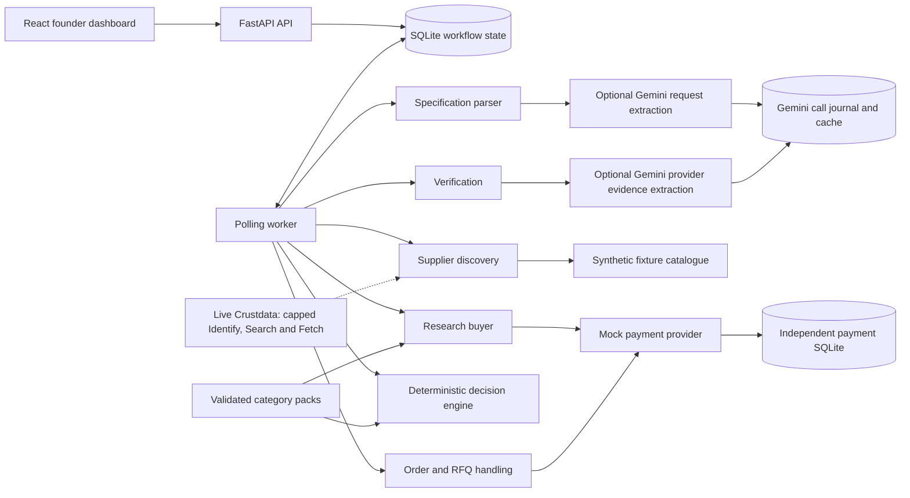
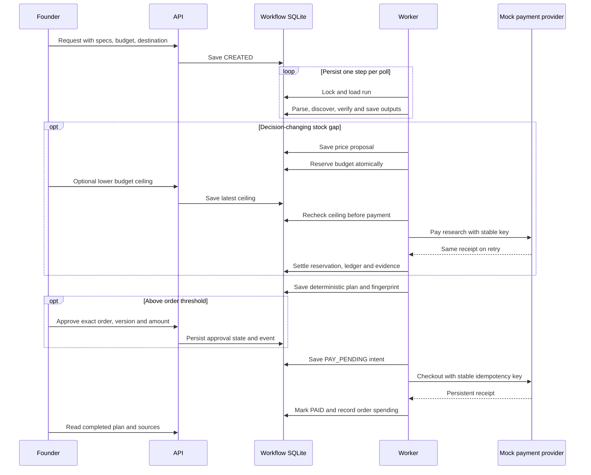

# Architecture

Generalization update: requests accept arbitrary product/service context, using a conservative general policy when no specialized internal profile exists. Product scope and outcome (purchase/shortlist) are independent. Failures and incomplete sourcing plans create persisted human-review tasks and pause the worker. Reviewers can revise/retry, record manual handling or cancel; no outside communication is sent. See `general-and-human-review.md` for the state flow, APIs and payment/budget safeguards.

A modular monolith exposes a local FastAPI API. A separate polling worker advances one durable step per transaction. Domain decisions do not import HTTP routes or provider SDKs. Pydantic models are the canonical contracts, exported to OpenAPI and generated frontend types.

## State and transactions

`runs.document` stores a validated WorkflowRun snapshot with events and typed stage outputs. Reservations and ledger entries have relational uniqueness constraints. SQLite `BEGIN IMMEDIATE` serializes concurrent writers, including separate API/worker connections. Multiple workers cannot advance the same saved state simultaneously. The live adapter currently holds this lock during bounded network I/O; replace this with persisted job leases before concurrent production use. Provider-credit intents and cached responses have a separate durable database so paid calls are not blindly repeated after a workflow rollback.

The research lifecycle spans multiple transactions: quoted, reserved, then paid/released. Lowering a ceiling between reservation and payment releases an uncommitted reservation. Previously committed provider effects are reconciled even if the ceiling subsequently drops. Accounting never erases actual commitments.

## Payment recovery

The payment simulator owns an independent SQLite database so its commit survives a rollback or death of the workflow worker. `PAY_PENDING` is saved before payment. The provider enforces a unique idempotency key and checks that the amount/account match the original payload. After a timeout or crash the worker looks up the same key and records its receipt; it does not generate a new key for a retry.

Before replanning changed or expired evidence, execution reconciles any already committed pending payment. Paid items are preserved and excluded from replacement orders. This prevents a quote change during recovery from causing a second purchase.

This demonstrates one payment effect with at-least-once execution. A real integration needs durable provider idempotency, receipt lookup and reconciliation. Application state alone cannot guarantee exactly-once effects at an arbitrary external payment service.

## Evidence and decision boundaries

When `llm_enabled` is true, Gemini has exactly two responsibilities: parse the user request during PARSING, and extract cited supplier facts/summaries during VERIFYING. Schemas, prompts, source-scope checks and persistent model-call limits are described in `llm-layer.md`. Extracted live purchasing claims remain unverified and cannot independently authorize an order. The Crustdata cap remains 0.2 credits, separate from Gemini token usage.

Identity is merged only on canonical company IDs. Hiring is one trust signal; it is not proof of manufacturing. Authorized electronics distributors remain acceptable. Unverified critical identity, stock, shipping, specifications, delivery or stale evidence blocks automatic purchase. Unresolved candidates remain visible with reason codes.

The cost engine computes goods, shipping, duty and tax with integer paise and Decimal rounding. Shipping is per item quote/shipment; consolidation is deliberately not modelled. Reliability and evidence coverage are separate values. Eligible quotes are ordered by landed cost, then reliability and stable supplier ID. No LLM has authority to change eligibility, budgets or checkout permissions.

The generic transport helper supports timeout handling, bounded retries, Retry-After parsing, response validation, sanitized errors and TTL cache keys. The live Crustdata client instead avoids automatic paid retries, uses the documented API version and endpoint contracts, reads account-specific prices, journals spending intent before each call and defaults to 0.2 provider credits per run. Identity-only runs use explicit supplier domains; other live purchasing facts remain unknown. Search redirects are normalized or rejected before company resolution. See `live-test.md` for the initial redirect defect found during the real test and its offline fix.
