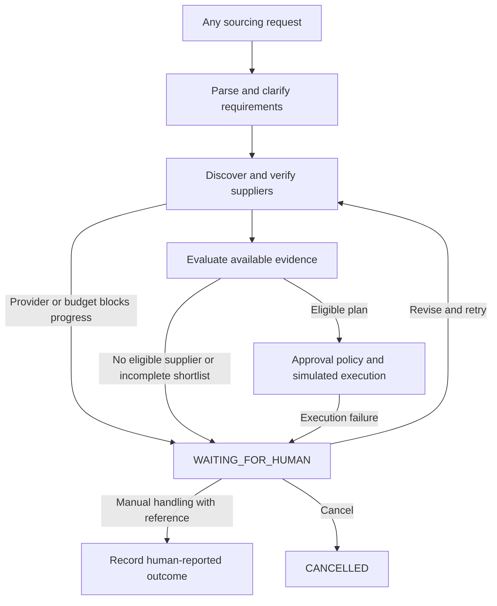

# General sourcing and human review

The primary workflow accepts **any product or service context**. `category` is now an optional descriptive string, defaulting to `general`, rather than an electronics/leather enumeration. Purchase planning and supplier shortlisting are separate `request_type` choices. Live queries use the parsed descriptions, parameters and destination; no electronics-only or Uttar-Pradesh-only search is built into the live engine.

Gemini's request schema accepts arbitrary context labels and item parameters. Context differences do not block parsing. Existing electronics and leather fixture catalogues remain optional offline examples, not a restriction on live requests. Other fixture contexts return no fabricated suppliers.

## Conservative general policy

Unknown contexts use the validated `general.json` policy. It requires identity, specification/destination evidence, freshness and reliability checks. Unconfirmed tax/duty rules produce `COST_POLICY_UNCONFIRMED` and an incomplete cost, rather than inventing zero-tax landed prices. Existing specialized demo packs can still be used internally. This accepts broader requests; it does not claim that every item can be purchased automatically or every specialized verification is implemented.

The original live purchasing limitation remains: Gemini-derived quotes are unverified until an independent check confirms them, and payments remain simulated. The new human loop gives those cases a concrete next step.

## Handoff lifecycle



`human_review_enabled` defaults to true. Provider/access/budget failures, invalid model responses, incomplete plans and execution exceptions create a durable `HumanReviewTask`. Runs pause in `WAITING_FOR_HUMAN` and the worker stops making provider calls. A single pending task is reused on duplicate escalation requests. The founder can also request a human explicitly during clarification or other unfinished states.

The dashboard shows a **Human review inbox** with a pending count. Each task links to the request, affected item IDs, reasons, evidence, previous model output and spending records. This is an in-app queue: the implementation does not email, call or notify an outside procurement agent. Reviewer names are locally entered audit labels; production identity/authorization and external notifications remain future work.

## Reviewer actions

- **Revise and retry:** record a reviewer and note, optionally supply structured specs or revised text, and explicitly change supplier domains/credit limits. The saved stage determines where work resumes. Spending journals, response caches and order idempotency keys stay intact; a retry cannot reset a budget. Material changes invalidate the plan. Requests already paid or manually handled cannot be rewritten as different requirements.
- **Record manual handling:** requires a completion reference plus notes. It records human-reported handling for the blocked items, as distinct from an automated payment. Evidence is labelled unverified; no fake PAID order or independent verification is generated. Remaining eligible work is recomputed normally.
- **Cancel remaining work:** pauses no further work and preserves previous payment/accounting records. It does not imply a refund.

Pending or ambiguous checkout must first be reconciled by an unchanged retry. Manual handling/cancellation and order-changing revisions are rejected while payment is pending. Resubmitting an identical resolution is idempotent; a different resolution for the same task is rejected.

## API

- `GET /api/human-reviews`: pending tasks across saved runs.
- `POST /api/runs/{id}/human-review`: explicit handoff with `{ "note": "Please review the supplier evidence." }`.
- `POST /api/runs/{id}/human-reviews/{task_id}/resolve`: reviewer decision.

Example manual resolution:

```json
{
  "reviewer": "Procurement lead",
  "action": "manual_completion",
  "note": "Confirmed requirements and handled these items outside the application.",
  "reference": "PO-MANUAL-42"
}
```

Example retry with an explicit provider-budget change:

```json
{
  "reviewer": "Founder",
  "action": "retry",
  "note": "Authorize a broader supplier search within this new ceiling.",
  "supplier_domains": [],
  "provider_credit_limit": "2"
}
```

The ceiling is not a promise that all checks can be completed for that price. The default remains 0.2 credits; every paid call still passes account-price preflight and the persisted spending gate. Only Google Gemini models are used for model work. Gemini costs are separate from Crustdata credits.

## Test without paid API calls

Choose offline fixture mode, disable Gemini, enter any context such as `packaging`, and provide structured specs. Because that demo catalogue has no packaging suppliers, it creates a human-review task rather than manufacturing a supplier. Resolve it through the dashboard's reviewer controls. Automated tests cover that flow, manual outcomes, cancellation, retries, idempotency and payment reconciliation.
